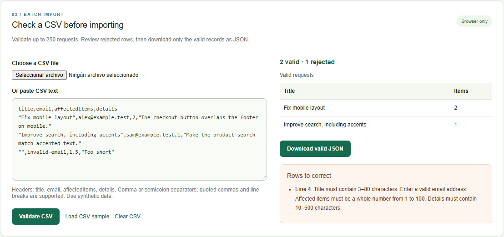

# Angular / Ionic — validated forms and CSV import

A personal demonstration by **Ivan Delgado**, developed with AI assistance and synthetic data. It shows how to improve an existing form and turn a small CSV upload into a clear, reviewable workflow.

[](https://github.com/ivaaandeelgado/freelance-angular-form-demo/actions/workflows/checks.yml)



## What works

- Angular Reactive Forms with Ionic inputs, whitespace/email/integer validation and typed JSON output.
- Local CSV upload or pasted text; comma and semicolon delimiters, UTF-8 BOM, escaped quotes and quoted line breaks.
- Physical line numbers and useful errors for rejected records; valid rows remain available for review.
- A JSON download containing only valid records. Editing the input clears the previous validation result.
- Bounded input: 200,000 bytes per uploaded file, 200,000 characters for pasted text and 250 data rows.
- Responsive desktop/mobile UI, file-reading feedback and oversized-file handling.

Processing stays in the browser. There is no backend, telemetry, stored submission or external request containing form data. The optional JSON download writes a file only when requested.

## Run and explore

Requires **Node.js 24** and npm.

```sh
npm ci
npm start
```

Open **http://127.0.0.1:4317**. On Windows PowerShell use `npm.cmd` if script execution is disabled.

Try **Load example → Validate request** for the individual form. Then choose **Load CSV sample → Validate CSV**: two valid rows and one rejected row demonstrate correction and export. All sample addresses use fictitious example domains.

## CSV contract

Use these four unique headers, in any order:

```csv
title,email,affectedItems,details
Fix mobile layout,alex@example.test,2,The footer overlaps the checkout button.
```

Titles must have 3–80 trimmed characters; details 10–500; affected items an integer from 1 to 100; email must pass a practical format check. Invalid headers, malformed quoting or exceeded limits reject the whole import. Field errors reject only the affected row. Empty records are skipped. Formula-like strings remain literal JSON values; this demo does not export executable spreadsheet formulas.

## Verify

```sh
npm run build
npm test
```

The test suite contains **7 parser tests and 5 browser tests**. It checks mixed valid/invalid rows, quoting, line numbers, limits, form correction, file upload, actual JSON download and mobile overflow. Local browser tests use an installed Google Chrome in a separate headless session. CI uses Chromium and Node 24 on a standard Ubuntu runner.

Tests start/stop their own server. Stop a manually running demo first. Screenshots and detailed test output go to ignored `evidence/`; the portable [verification summary](docs/verification.json) records the local run.

## Code map

| File | Responsibility |
| --- | --- |
| `src/main.ts` | Typed single-request form with Ionic inputs |
| `src/csv-import.ts` | Pure, independently tested CSV parser and validation |
| `src/csv-import.component.ts` | File/paste UI, error review and JSON download |
| `src/styles.css` | Responsive layout and interaction states |
| `unit-tests/` | Parser edge cases and bounds |
| `tests/` | Browser behavior and download checks |

[Full desktop screen](docs/screenshots/desktop-validated.png) · [Mobile CSV](docs/screenshots/csv-mobile.png)

This is a bounded portfolio sample, not a delivered client project or proof of past Ionic client work. A real API must enforce its own validation and authorization. Native Android/iOS packaging, persistent storage and deployment are outside this sample. Dependencies retain their open-source licenses and are pinned by `package-lock.json`.

References: [Angular Reactive Forms](https://angular.dev/guide/forms/reactive-forms) and [Ionic inputs](https://ionicframework.com/docs/api/input).
